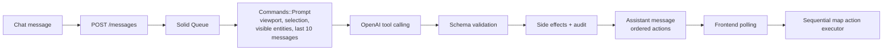

# Tactical Map

Tactical Map is a full-stack, map-based application (Rails 8, Inertia, React) where users create, place, view, and filter entities on a live tactical map using natural-language commands — typed or spoken. OpenAI tool calling translates each command into one or more validated map actions, and every command and action is durably recorded in an operator-facing audit log.

**Live demo:** https://tactical-map.onrender.com — sign in with `demo@example.com` / `password123`.

## How the requirements are addressed

**Create, place, view, and filter entities via voice or typed commands.** The chat accepts typed commands, and the composer's microphone button dictates commands via the browser's `SpeechRecognition` API. The command vocabulary is a small set of server-owned tools:

| Tool | Purpose |
| --- | --- |
| `fly_to` | Pan and zoom to an entity, coordinate, or geographic bounds. |
| `filter_entities` | Restrict visible entities by kind, status, name, or scope. |
| `place_marker` | Create a named marker at a latitude and longitude. |
| `show_history` | Draw the recent position trail for an entity. |
| `open_details` | Open the selected entity's information panel. |
| `clear_filters` | Restore the unfiltered entity view. |
| `ask_clarification` | Ask a focused follow-up question, optionally with choices. |
| `set_weather_overlay` | Show or hide an OpenWeather layer over the map. |
| `delete_marker` | Permanently delete an operator-placed marker. |

**Ambiguity handling.** When a command is unclear ("show me the ship" when three ships are visible), the model calls `ask_clarification` instead of guessing. The question renders in the chat with tappable choice chips, and the operator's answer resolves the original request. The same principle applies to voice: dictated text stays in the composer for correction rather than auto-sending, so a misheard callsign never becomes a command.

**Audit / historic event log.** Every action and mutation writes one durable `AuditEvent` row, viewable in the audit drawer. Separately, each model call is captured as an `AiRequest` with the exact prompt, response, model name, and token usage — so there is both an operator-facing history and a model-level request record.

**Serialized actions.** A single command like "find the nearest aircraft, zoom to it, and open its details" produces an ordered list of tool calls. Each is schema-validated on the server, side effects and audit rows are applied in order, and the browser replays the ordered action list through a sequential map executor so the operator sees each step happen.

## Stack choice

Rails 8, Inertia, React, and Postgres. The assessment encourages the tools you can best demonstrate with, and I'm a Rails developer — this stack was the fastest path from empty repo to a working full-stack app, with authentication, background jobs (Solid Queue), and migrations all in the framework.

Inertia bridges the two halves: Rails renders and routes React components directly, with no separate API app to build or deploy. Once a page is mounted in the browser it behaves like an SPA — from there, TanStack Query (react-query) handles all server state: polling entities, tracking message status, and mutations. The UI is built on shadcn/ui components with Tailwind, and Mapbox GL JS renders the map.

## The map UI

Mapbox GL JS (v3) renders the map — a globe when zoomed out — on a dark basemap tinted for a tactical look. Entities are drawn as GeoJSON layers on top: kind-specific symbols with leader lines showing heading and speed, faded history trails with a soft halo, and a nautical-mile scale control. The chat, entity details panel, filter chips, and audit drawer sit alongside the map.

The world itself is simulated. The database is seeded with 40 assets around Halifax — 18 ships, 12 aircraft, 10 vehicles — each with 24 hours of pre-seeded position history so trails render immediately. A recurring Solid Queue job (`SimulationTickJob`, every 30 seconds) advances each active asset along its heading with a small random drift, appends a new `EntityPosition`, and prunes history older than 24 hours — so the map is always in motion and "show me its recent track" always has real data behind it.

I debated pulling live flight data from the OpenSky Network API, but chose simulation for simplicity: demos stay deterministic, and there are no third-party rate limits, auth, or availability concerns. The `Entity` model is the seam where a live adapter would slot in later.

Weather overlays are also appended to the Mapbox map. The `set_weather_overlay` tool (or the Weather toolbar button) adds an OpenWeather tile layer as a Mapbox raster source, rendered at 55% opacity beneath the tactical layers so entities stay legible. Tiles are fetched through a Rails proxy (`/weather/tiles/:layer/:z/:x/:y`) so the OpenWeather key never reaches the client, with a 30-minute browser cache.

## Architecture

The HTTP request is intentionally short: it persists the command and hands model work to Solid Queue. Model context (viewport, selection, visible entities, recent messages) is assembled on the server, tool output is schema-validated before any effect is applied, and the browser receives only an ordered action list.



### Data model

| Model | Purpose |
| --- | --- |
| `User` | Authenticated operator, backed by Rails authentication and sessions. |
| `Entity` | Current ship, aircraft, vehicle, or marker state and flexible JSON properties. |
| `EntityPosition` | Time-stamped historical positions used for trails and simulation history. |
| `Conversation` | Container for a user's rolling message history. |
| `Message` | User or assistant content, processing status, context, and ordered assistant actions. |
| `AiRequest` | Exact model prompt/response, model name, token usage, and errors. |
| `AuditEvent` | One durable, user-visible record per action or mutation. |

Two denormalizations are deliberate. `entities.lat`/`lng` hold the current position so frequent entity polling never joins for "latest position". And `audit_events` overlaps with `messages.actions`: actions are optimized for chat replay, while audit rows stay independently queryable even if the message payload evolves.

### Tradeoffs

- **Async processing + polling, not WebSockets.** Model latency shouldn't hold an HTTP request open, and polling is simple to deploy and robust for one active client. ActionCable is the natural upgrade for multi-client or lower-latency delivery.
- **Constrained tool vocabulary, not an open-ended agent.** The model can only act through nine server-owned tools. That makes every action predictable, validatable, and auditable — and pairs with the ambiguity requirement, since a model that can't improvise must ask instead. The cost is that the model can't do anything the vocabulary doesn't anticipate; extending capability means deliberately adding a tool, its schema, and its audit shape.
- **Float `lat`/`lng` columns, not PostGIS.** Positions are plain floats rather than a PostGIS `geography(Point)` column. PostGIS would give indexed spatial queries in SQL — "nearby nodes" via `ST_DWithin`/KNN ordering, true geodesic distances, viewport bounding-box filters — where today the seeded set is small enough that entities are polled to the client and spatial reasoning happens over the visible-entity context. Floats keep the schema and deployment plain Postgres with no extension to manage; PostGIS is the right move as soon as the entity count outgrows "send everything to the browser".
- **Browser speech recognition, not server-side Whisper.** A Whisper endpoint would need an audio upload path and object storage to operate; browser `SpeechRecognition` needs neither — audio never leaves the browser and interim text streams live. The cost is Firefox, where the API is unavailable and the mic renders disabled with an explanation. For the demo, sacrificing Firefox was the better trade than standing up object storage; Whisper remains the natural upgrade.

## Security

The model never touches the application directly — it can only propose tool calls, and every call is validated against a server-owned JSON schema before any side effect is applied. There is no free-form SQL, code execution, or generic "do anything" path for a prompt-injected command to reach. The one destructive tool, `delete_marker`, re-checks the entity kind server-side and refuses to delete ships, aircraft, or vehicles even if the model asks.

Secrets stay on the server: the OpenAI key is only used from background jobs, and OpenWeather tiles are fetched through a Rails proxy so that key never reaches the browser. The Mapbox token is a public client-side token by design, with a URL restriction configured in Mapbox so it only works from this application's origins. All routes sit behind Rails session authentication.

Model output quality is a security surface too. In a production setting the system prompt would live in LangSmith with an eval suite run against every prompt change — regression checks that representative commands map to the expected tool calls (and that ambiguous ones produce clarifications, not guesses) — so hallucinated actions or degraded output can't drift in silently as the prompt evolves. Today the equivalent guard is the RSpec suite around prompt construction and response validation.

## Performance

Token cost is bounded by construction: the model's context is the viewport, the current selection, visible entities, and the last 10 messages — it does not grow with conversation length or fleet history. On the data side, the current position is denormalized onto `entities` so the map poll is a single indexed query with no "latest position" join, `entity_positions` is pruned past 24 hours so the hot table stays small, and weather tiles carry a 30-minute browser cache.

At scale, two upgrades are queued behind clear seams. Entity filtering and viewport queries would move from the client into indexed server queries — with PostGIS, real-world spatial questions ("assets within 10 nm of this point", "nearest aircraft to the selection") become single indexed SQL calls the model could invoke as tools instead of reasoning over a context list. And commands could be classified before hitting the LLM: deterministic ones like "clear filters" don't need a model at all, and simple single-tool commands could route to a smaller/faster model, reserving the full tool-calling loop for genuinely compound requests.

## Quick start

You need Ruby 3.3, Node.js 24, pnpm 11, and PostgreSQL.

```sh
bin/setup                  # install dependencies, prepare databases
cp .env.example .env       # then fill in OpenAI, Mapbox, OpenWeather keys
bin/dev                    # Rails + Vite + process group
```

The seeded demo account is `demo@example.com` / `password123`. (New OpenWeather free-tier keys can take up to an hour to activate.)

## Testing

- Backend: `bundle exec rspec` — prompt construction, tool schema validation, OpenAI response handling, action auditing, idempotent side effects, simulation.
- Frontend: `pnpm test` — map reducer and sequential executor, clarification chips, speech-recognition handling and fallback, filters, trails, audit UI.
- Types: `pnpm check`.

## Deployment

`render.yaml` is a Render Blueprint for one Ruby web service and one PostgreSQL database. Create a Blueprint from this repository and provide `RAILS_MASTER_KEY`, `OPENAI_API_KEY`, `MAPBOX_ACCESS_TOKEN`, and `OPENWEATHER_API_KEY`; `DATABASE_URL` links automatically and the pre-deploy command prepares and seeds the databases.

## LLM use

LLMs were used both **in** the product and **to build** it.

- **In the product:** OpenAI tool calling with `gpt-5.4-mini` translates commands into map actions, constrained by server-owned JSON schemas per tool. The model was chosen for its speed and cost efficiency: commands should resolve in a couple of seconds, each one may involve several tool-calling round trips, and the small tool vocabulary with strict schemas doesn't need a frontier model to be reliable. The system prompt, context assembly, and validation live in `app/services/commands/`.
- **In development:** The project was built with Claude Code in a spec-first workflow. Claude did most of the scaffolding and setup (Rails 8 + Inertia + React app, auth, CI). Planning was done in Claude with Opus — requirements brainstormed into a written design spec and broken into implementation plans — and execution agents carried out the plan tasks using GPT-5.6 Sol, with the developer reviewing and directing each step. Claude's frontend-design skill was used to recolor and polish the UI. The actual specifications and plans given to the models are committed in `docs/superpowers/specs/` and `docs/superpowers/plans/`, so the prompting and workflow are inspectable in the repository itself. Claude also helped organize my thoughts into this README :)
