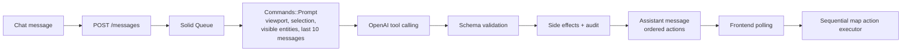

# Tactical Map

## What it is

Tactical Map is a Rails 8.1, Inertia, and React application for controlling a live tactical map with natural-language chat. A user can ask to find assets, move the viewport, inspect an entity, display its recent track, place a marker, or combine several of those operations in one command. OpenAI tool calling translates the request into validated map actions, while the application preserves both an operator-facing action log and a model-level request record.

> **Screenshot placeholder:** Add a dashboard screenshot here showing the chat, map, entity details, filter chips, and audit drawer.

## Quick start

You need Ruby 3.3, Node.js 24, pnpm 11, and PostgreSQL. Clone the repository, make sure PostgreSQL is running, and let the setup script install dependencies and prepare the development databases:

```sh
bin/setup
```

Copy `.env.example` to `.env` and replace the placeholders with valid OpenAI, Mapbox, and OpenWeather credentials (the OpenWeather key is free-tier; new keys can take up to an hour to activate). Start Rails, Vite, and the local process group with `bin/dev`, then open the URL shown in the terminal. The seeded demo account is `demo@example.com` with password `password123`.

## Architecture

The HTTP request is intentionally short: it persists the command and hands model work to Solid Queue. Model context is assembled on the server, tool output is schema-validated before any effect is applied, and the browser receives only an ordered action list that its map executor can replay visibly.



The command vocabulary is deliberately small. Each tool has a server-owned schema, and tool calls are processed in the order returned by the model.

| Tool | Purpose |
| --- | --- |
| `fly_to` | Pan and zoom to an entity, coordinate, or geographic bounds. |
| `filter_entities` | Restrict visible entities by kind, status, name, or scope. |
| `place_marker` | Create a named marker at a latitude and longitude. |
| `show_history` | Draw the recent position trail for an entity. |
| `open_details` | Open the selected entity's information panel. |
| `clear_filters` | Restore the unfiltered entity view. |
| `ask_clarification` | Ask a focused follow-up question, optionally with choices. |
| `set_weather_overlay` | Show or hide an OpenWeather layer over the map. |
| `delete_marker` | Permanently delete an operator-placed marker. |

### Weather overlays

"Show me weather overlays for the current zoom window" is handled by the
`set_weather_overlay` tool. It is client-executed like `fly_to`: the LLM emits
the action, the browser reducer stores the active layer and opens the Weather
panel, and MapCanvas renders it as a Mapbox raster layer under the tactical
layers. Tiles come from OpenWeather Maps 1.0 via a Rails proxy
(`/weather/tiles/:layer/:z/:x/:y`) so the API key never reaches the client;
the proxy sets `Cache-Control: public, max-age=1800` so the browser caches
tiles. The free tier serves current conditions only, so there is no forecast
time slider. The Weather toolbar button toggles the same panel the command
auto-opens.

### Voice input

The composer's microphone button uses the browser's `SpeechRecognition` API to
dictate a command. Interim results stream into the input as you speak, and the
transcript **stays in the box** — it is never auto-sent. That is deliberate:
speech models mangle callsigns and place names, and the same principle behind
`ask_clarification` applies one layer earlier, letting the operator correct a
misheard transcript before it becomes a command.

Dictation therefore resolves to ordinary text in the composer, and a spoken
command takes the identical path as a typed one — `POST /messages`, an
`AiRequest`, and `audit_events` rows. No new endpoint, no new persisted state.
Audio never leaves the browser for this application's servers, so there is no
upload path and no object storage to operate.

The audit log does not record whether a command was spoken or typed. A flag set
when dictation begins would remain set after the operator hand-edits the
transcript, labelling as "voice" a command a human actually rewrote — a tag
that reads as precise while being wrong. Recording this honestly means
comparing submitted text against the final transcript and marking only exact
matches, which is worth doing when someone needs the distinction and is not
worth a misleading field before then.

The tradeoff is browser support: `SpeechRecognition` is available in Chrome,
Edge, and Safari but not Firefox, where the mic renders disabled with an
explanation rather than disappearing. Chrome also relays audio to Google's
speech service. A server-side Whisper endpoint would avoid both issues and put
transcription itself under the audit trail, at the cost of a round trip and
losing live interim text; it remains the natural upgrade if either matters.

## Data model

The schema separates operational state, conversational state, and observability. One rolling conversation is exposed per user today, while the tables leave room for multiple named conversations later.

| Model | Purpose |
| --- | --- |
| `User` | Authenticated operator, backed by Rails authentication and sessions. |
| `Entity` | Current ship, aircraft, vehicle, or marker state and flexible JSON properties. |
| `EntityPosition` | Time-stamped historical positions used for trails and simulation history. |
| `Conversation` | Container for a user's rolling message history. |
| `Message` | User or assistant content, processing status, context, and ordered assistant actions. |
| `AiRequest` | Exact model prompt/response, model name, token usage, and errors. |
| `AuditEvent` | One durable, user-visible record per action or mutation. |

Two denormalizations are deliberate. `entities.lat` and `entities.lng` hold the current position even though position history also exists, keeping frequent entity polling free of a “latest position” join. Likewise, `audit_events` overlaps with `messages.actions`: actions are optimized for chat replay, whereas audit rows remain independently queryable and stable if the message payload evolves.

## Tradeoffs

Command processing is asynchronous because model latency and retries should not hold an HTTP request open. The browser polls message status rather than using WebSockets; this is simple to deploy and robust for one active client, at the cost of repeated requests and up to roughly one polling interval of added latency. ActionCable is a natural upgrade when multi-client or lower-latency delivery matters.

Solid Queue runs inside Puma on Render, which keeps the deployment to one web service but couples web and job capacity and makes `WEB_CONCURRENCY=1` important. The primary and queue roles share one Render Postgres database to reduce cost and operational overhead; separate migration paths preserve the logical boundary, but a queue spike can still contend with application queries. A larger deployment should split worker processes and, if needed, the databases.

The map uses seeded simulation instead of live aviation, maritime, or weather APIs, making demos deterministic and avoiding third-party availability and billing concerns. Entity filtering is client-side because the seeded set is small and already polled for map rendering. At larger scale, filters and viewport bounds should move into indexed server queries and live feeds should include explicit freshness and failure handling.

## Testing

Run the Rails suite with `bundle exec rspec` and the frontend suite with `pnpm test`. Check TypeScript independently with `pnpm exec tsc --noEmit` (or use the repository's `pnpm check` script for both configured TypeScript projects).

RSpec covers authentication and API requests, prompt construction, tool schema validation, OpenAI response handling, action auditing, idempotent marker side effects, simulation movement, and position pruning. Vitest and Testing Library cover the map reducer and sequential executor, clarification chips and chat interactions, speech-recognition transcript handling and its unsupported-browser fallback, filters, trails, and audit-facing UI behavior. Model calls are stubbed at the HTTP boundary so the suites do not require an OpenAI key.

## Deployment

The included `render.yaml` is a Render Blueprint for one Ruby web service and one PostgreSQL database. Create a new Blueprint in Render from this repository, review the proposed resources, and provide `RAILS_MASTER_KEY`, `OPENAI_API_KEY`, `MAPBOX_ACCESS_TOKEN`, and `OPENWEATHER_API_KEY` when prompted. `DATABASE_URL` is linked automatically from the managed database, and the pre-deploy command prepares and seeds both the application and Solid Queue schemas.

The service builds through `bin/render-build.sh`, starts Puma, and runs Solid Queue in the Puma process. The production database configuration maps both Rails' `primary` and `queue` roles to the same `DATABASE_URL`; this is intentional for the starter deployment and should be revisited before independently scaling web and job workloads.

## Extension points

- **Server-side transcription:** Swap browser `SpeechRecognition` for a Whisper endpoint to gain Firefox support and bring the audio-to-text step itself into the audit trail. The composer already treats the transcript as ordinary text, so only the hook changes.
- **Live data:** Introduce adapters for feeds such as OpenSky and weather layers while retaining the `Entity` boundary and marking source freshness in `properties`.
- **Multiple conversations:** Add names and conversation selection to the existing `conversations` table without changing the message processing loop.
- **ActionCable:** Replace terminal-status polling with server push while keeping the same assistant-message and ordered-action contract.
